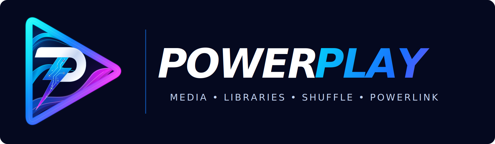
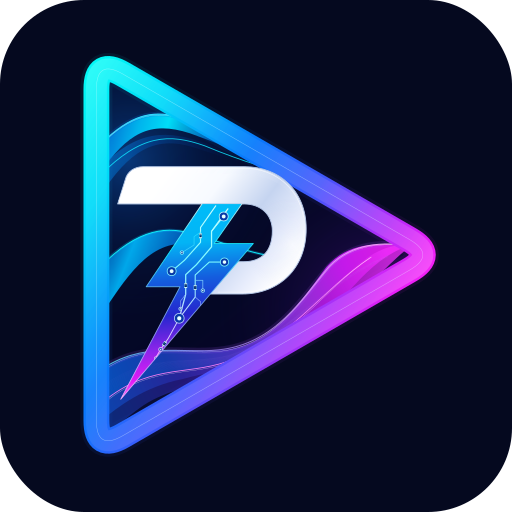

# PowerPlay

**Plex on Fire TV, built around the remote — with smart shuffle, seamless handoffs, and Home Assistant control.**

*An independently maintained, GPL-3.0-licensed fork of [Plezy](https://github.com/edde746/plezy). Not affiliated with Plex, Plezy, or Amazon.*

[Get PowerPlay](#download) · [Features](#features) · [PowerShuffle](#powershuffle) · [PowerLink](#powerlink--room-to-room-playback) · [Home Assistant](#home-assistant--automations) · [History](#version-history)

---

## Download

### [Get the latest stable PowerPlay release](https://github.com/The-Power-0/PowerPlay/releases/latest)

The link always points to the **current stable release**. Under **Assets**, download the `PowerPlay-vX.Y.Z.apk` file for Fire TV. The same release includes version-matched source archives and SHA-256 checksums.

**Install:** Sideload the APK using ADB or another Fire TV sideloading tool. With Android platform tools installed:

~~~bash
adb install -r PowerPlay-vX.Y.Z.apk
~~~

A matching signing certificate permits an update in place. If Android reports `INSTALL_FAILED_UPDATE_INCOMPATIBLE`, the existing app was signed with a different key. Reinstallation may require uninstalling the previous package, **which deletes its local app data**; back up what you need first.

**Current milestone:** [PowerPlay 1.4.0](https://github.com/The-Power-0/PowerPlay/releases/tag/powerplay-v1.4.0) introduces PowerShuffle and works with [PowerLink 0.3.0](https://github.com/The-Power-0/PowerLink/releases/tag/v0.3.0).

## Why PowerPlay exists

PowerPlay started with a simple goal: let Home Assistant start a Plex show's **continuous shuffle on a Fire Stick** without navigating the app by hand.

That experiment grew into an independent Fire TV client. The original Plezy fork was refined for movies and television, responsive D-pad controls, predictable startup and playback, and lighter background work. The Fire TV edition uses **ExoPlayer / Media3** rather than the former MPV runtime, and keeps its own application ID (`com.power.powerplay`) and `powerplay://` deep links so it can coexist with Plezy.

Today PowerPlay brings together three things: a focused Plex viewing experience, **PowerShuffle** for episode rotation without unwanted repeats, and **PowerLink** for moving a playing queue between rooms. Upstream Plezy fixes are evaluated selectively rather than incorporated automatically.

## Features

| | |
| --- | --- |
| **Plex-first playback** | Movies and TV shows with Fire TV-focused navigation and ExoPlayer / Media3 playback. |
| **PowerShuffle** | Per-show intelligent randomization with completion history, two skip choices, and automatic cycle rollover. |
| **PowerLink** | Transfer the active episode, position and queue between paired Fire Sticks, with compatible HD/4K matching. |
| **Fire TV performance** | Tuning for startup, artwork loading, network activity, memory use and D-pad responsiveness. |
| **Hardware-aware libraries** | Recognized 1080p-only devices hide libraries ending in `[4K]` by default; 4K-capable devices keep them visible even in a 1080p HDMI mode. |
| **Ten themes** | Curated palettes, including multicolor Aurora and Synthwave, with Light, Dark, System and OLED appearance options. |
| **Home Assistant ready** | Deep links, room-specific launch actions, and an optional HACS integration that owns PowerLink/PowerShuffle state. |

The `[4K]` library behavior is a **user-adjustable default**, not an access restriction. Manual library visibility choices are preserved.

## PowerShuffle

**Shuffle one show without losing track of what you've already seen through PowerShuffle.**

On a TV show's detail page, choose **PowerShuffle** instead of ordinary Shuffle. Home Assistant keeps an independent, per-Plex-profile episode history and builds a randomized rotation from eligible episodes. Normal Plex watched status, ordinary playback, and the existing Shuffle action do **not** change PowerShuffle history.

### Two deliberate skip choices

| Action | What happens |
| --- | --- |
| **Skip for 5 days** | The episode stays out of PowerShuffle for **120 elapsed hours**, including across a cycle change. |
| **Skip until next cycle** | The episode is deferred for the rest of the current rotation; it returns when the next rotation begins. |

Press **Next** during an unfinished PowerShuffle episode to choose. The Fire TV dialog has two selectable options, D-pad navigation, and **Back to cancel**. Normal pause, exit, shutdown, or handoff does not count as a skip.

### How a rotation works

1. PowerShuffle randomizes episodes that haven't been completed in the current rotation and aren't excluded by a skip.
2. Completion is based on **unique viewed content** (90% by default), not simply seeking to the end. Verified automatic intro/credits skips are taken into account.
3. Incomplete episodes remain available and restart from the beginning if chosen again. An active PowerLink handoff preserves the in-progress playhead instead.
4. When the rotation is fully completed, the next one begins. If every remaining episode has been deferred **until next cycle**, PowerShuffle records a **partial rotation** and advances without treating those episodes as watched.
5. Recently completed episodes get soft repeat protection (seven days by default). A five-day skip remains a hard exclusion; if none are eligible, playback waits rather than ignoring that skip.

**Recent queues resume:** PowerShuffle keeps the same randomized order during a recent session. After 12 hours of inactivity by default, it builds a new order from the currently eligible pool **without resetting watched progress or skips**. Home Assistant retains the complete logical rotation; the Fire Stick uses a small rolling window.

### Getting started

PowerShuffle requires **PowerPlay 1.4.0+** and the **[PowerLink HACS integration 0.3.0+](https://github.com/The-Power-0/PowerLink)** on a reachable Home Assistant instance.

1. Install and configure PowerLink in Home Assistant, then register and pair your Fire Stick in **PowerPlay → Settings → PowerLink**.
2. Open a Plex TV show and select **PowerShuffle**.
3. Use Home Assistant's **PowerLink → Configure → Manage PowerShuffle shows** to view tracked shows, reset a cycle or clear five-day skips. **PowerShuffle global settings** controls the completion threshold, queue inactivity, recent-repeat protection, queue window and specials.

Every Plex profile has its own progress. Starting the **same active show's** PowerShuffle on another paired Fire Stick can automatically request a PowerLink transfer.

## PowerLink — room-to-room playback

**Play in one room. Continue in another.**

PowerLink uses Home Assistant to discover **already-integrated** Fire Sticks, handle power-on routines, prepare the correct Plex media versions and transfer an ordered queue. From the player, select the **PowerLink** icon and choose a registered destination. The source is paused **only after** the destination confirms playback started.

- Preserves shuffled or sequential queue order and the current playback position.
- Supports HD/4K alternatives when matching versions of the same media can be verified.
- Uses scoped, per-device pairing credentials rather than a Home Assistant administrator token in the app.
- Supports custom Home Assistant wake routines and eligible routed networks; it does **not** automatically create a tunnel or discover unknown LAN devices.

PowerShuffle sessions also travel through PowerLink, preserving their cycle and completion history. See the [PowerLink setup guide](https://github.com/The-Power-0/PowerLink#setup) for installation, device registration and pairing.

## Home Assistant & automations

PowerPlay responds to Android VIEW intents using its own URI scheme. A controller can target the Fire Stick that should receive a normal Plex playback request.

| Action | Example |
| --- | --- |
| **Shuffle one Plex show** | `powerplay://shuffle?server=SERVER_ID&show=SHOW_RATING_KEY` |
| **Open a Plex item in shuffle mode** | `powerplay://play?server=SERVER_ID&id=SHOW_RATING_KEY&mode=shuffle` |
| **Open PowerPlay on a registered TV** | `powerlink.open_device` in Home Assistant |
| **Transfer current playback** | In-player PowerLink control or `powerlink.capture_handoff` |

`SERVER_ID` and `SHOW_RATING_KEY` are Plex identifiers, **not show names**. The examples above are the existing **standard Shuffle** links, not PowerShuffle commands. PowerShuffle starts from its dedicated show-detail action and requires the PowerLink companion.

Home Assistant can combine these actions with its existing ADB entities, dashboards, scenes, wake scripts and presence automations. PowerPlay handles the media request; Home Assistant determines **which TV** to use and **how to turn it on**.

## Compatibility

| Item | Support |
| --- | --- |
| Target hardware | Amazon Fire TV / Fire TV Stick |
| Fire OS | 7 and 8 |
| Release APK | Signed `armeabi-v7a` (32-bit ARM) |
| Video | ExoPlayer / Media3 with bundled codec support |
| App ID | `com.power.powerplay` |
| Deep link scheme | `powerplay://` |
| PowerShuffle companion | PowerLink 0.3.0 or later in Home Assistant |

Published release workflows verify the APK identity, signature, architecture and source artifacts. Automated CI **does not replace** testing controls, playback and quality mapping on actual Fire Sticks.

## Version history

PowerPlay versions begin with the independent 1.0.0 rebrand. Pre-1.0 Plezy-based builds are documented in the [legacy archive](docs/archive/README.md).

| Version | Milestone |
| --- | --- |
| **[1.4.0](https://github.com/The-Power-0/PowerPlay/releases/tag/powerplay-v1.4.0)** | **PowerShuffle**: per-profile show rotations, two skip durations, completion tracking, automatic cycle rollover, Home Assistant management and handoff continuity. Companion: PowerLink 0.3.0. |
| [1.3.10](https://github.com/The-Power-0/PowerPlay/releases/tag/powerplay-v1.3.10) | Holds the destination screen awake while a PowerLink queue and first video frame initialize. |
| [1.3.9](https://github.com/The-Power-0/PowerPlay/releases/tag/powerplay-v1.3.9) | Repairs destination-picker focus and D-pad navigation. |
| [1.3.8](https://github.com/The-Power-0/PowerPlay/releases/tag/powerplay-v1.3.8) | Repairs the Fire TV pairing keyboard, field and button navigation. |
| [1.3.7](https://github.com/The-Power-0/PowerPlay/releases/tag/powerplay-v1.3.7) | Adds the in-player PowerLink picker and per-device pairing. |
| [1.3.6](https://github.com/The-Power-0/PowerPlay/releases/tag/powerplay-v1.3.6) | Improves destination playback takeover and source pause confirmation. |
| [1.3.1](https://github.com/The-Power-0/PowerPlay/releases/tag/powerplay-v1.3.1) | Restores episode labels and thumbnails in imported queues. |
| [1.3.0](https://github.com/The-Power-0/PowerPlay/releases/tag/powerplay-v1.3.0) | Introduces PowerLink queue transfer, exact positions and 1080p/4K matching. |
| [1.2.4](https://github.com/The-Power-0/PowerPlay/releases/tag/powerplay-v1.2.4) | Transparent splash artwork and four additional themes. |
| [1.2.1](https://github.com/The-Power-0/PowerPlay/releases/tag/powerplay-v1.2.1) | D-pad focus scrolling stability. |
| [1.2.0](https://github.com/The-Power-0/PowerPlay/releases/tag/powerplay-v1.2.0) | Six curated themes and OLED appearance. |
| [1.1.2](https://github.com/The-Power-0/PowerPlay/releases/tag/powerplay-v1.1.2) | Splash-screen background and branding alignment. |
| [1.1.1](https://github.com/The-Power-0/PowerPlay/releases/tag/powerplay-v1.1.1) | Hardware-aware `[4K]` library defaults. |
| [1.1.0](https://github.com/The-Power-0/PowerPlay/releases/tag/powerplay-v1.1.0) | Fire TV playback defaults and startup refinements. |
| [1.0.0](https://github.com/The-Power-0/PowerPlay/releases/tag/powerplay-v1.0.0) | First independent PowerPlay package, purple branding and Plex-only Fire TV build, based on **Plezy 2.25.0**. |

For full changes and older versions, see [all releases](https://github.com/The-Power-0/PowerPlay/releases). The original Plezy baseline is **2.25.0**, not the outdated 2.24.0 reference found in some historical descriptions.

## Builds, source & license

PowerPlay is an independent derivative of [Plezy by edde746](https://github.com/edde746/plezy), distributed under the [GNU GPL v3](LICENSE). Original attribution and applicable third-party notices are retained; [the upstream README](UPSTREAM-README.md) remains available for background.

Each recent release includes the signed APK, a **version-matched source archive**, bundled native-source inputs and a checksum manifest. Use those attachments, **not GitHub's automatic source ZIP**, to locate the source corresponding to a published APK. The signing key is not distributed. Release production uses a [candidate workflow](.github/workflows/powerplay-release-candidate.yml), a separate [publish workflow](.github/workflows/powerplay-publish.yml) and [release metadata](.github/powerplay/release.json).

The project does not claim that every transitive native-dependency licensing, source-supply or trademark question has been fully audited or cleared. Check applicable obligations before redistributing.

*Pick a show. Press play. Let PowerPlay handle the rest.*

